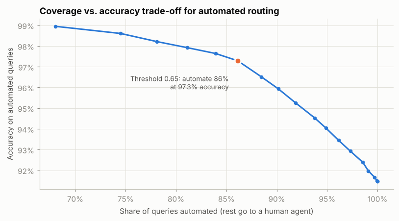
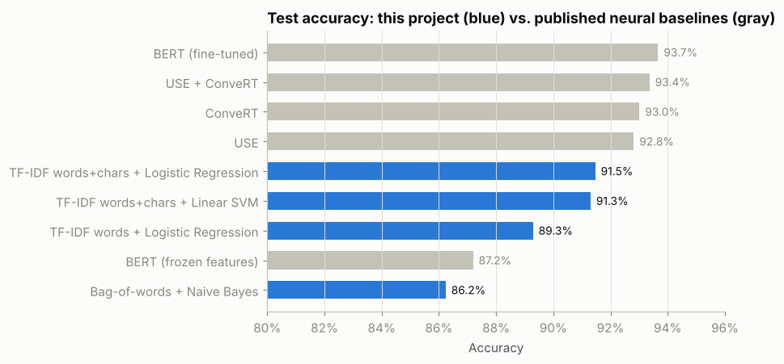

# Banking Customer Intent Classification

**Can a bank's digital assistant route free-text customer questions to the right intent automatically — and know when to hand off to a human?**

Using 13,083 labeled banking queries across 77 intents, this project builds and evaluates text classifiers from a bag-of-words baseline to word + character TF-IDF models, then turns the model into a business decision: how much can be safely automated at a target accuracy.

It's a public-data rebuild of a query classifier I built for a major U.S. bank's mobile voice assistant, which raised app bookings 20%.



## Key results

| | |
|---|---|
| **Selected model** (by 5-fold CV) | TF-IDF words + characters → Linear SVM |
| **Test accuracy** | **91.3%** (95% bootstrap CI: 90.3%–92.3%), macro-F1 91.3% |
| **vs. bag-of-words baseline** | +5.1 points (86.2% → 91.3%), McNemar exact p < 0.001 |
| **vs. fine-tuned BERT** (published) | 2.4 points lower, at a fraction of the compute (CPU only, trains in under a minute) |
| **Business operating point** | Automate **86%** of queries at **97.3%** accuracy; route the other 14% to agents |

## What's in the analysis

1. **Exploration:** query length, class imbalance, and why macro-F1 is reported alongside accuracy.
2. **Model selection without test leakage:** four models tuned with stratified 5-fold CV on the training set only. The test set is used once.
3. **Statistical evaluation:** bootstrap confidence intervals and a McNemar test on paired predictions, rather than just comparing headline accuracy.
4. **Error analysis:** the most-confused intent pairs (e.g., `top_up_failed` vs. `top_up_reverted`) with real examples, and what to do about them.
5. **Confidence-based routing:** the coverage/accuracy trade-off curve that a product owner needs to set an automation threshold.
6. **Learning curve:** whether paying for more labeled data would still improve accuracy.



| Model | CV accuracy | Test accuracy | 95% CI |
|---|---|---|---|
| TF-IDF words+chars + Linear SVM *(selected)* | 90.2% | 91.3% | 90.3%–92.3% |
| TF-IDF words+chars + Logistic Regression | 90.1% | 91.5% | 90.5%–92.5% |
| TF-IDF words + Logistic Regression | 88.0% | 89.3% | 88.2%–90.4% |
| Bag-of-words + Naive Bayes | 84.8% | 86.2% | 85.0%–87.5% |

The two word + character models are statistically tied on test. The CV winner is reported as the selected model rather than the one that happened to score highest on test.

## Takeaways for the business

- **A simple, cheap model gets most of the way.** A linear model on character and word n-grams is within about 2.4 points of fine-tuned BERT, easy to explain, and runs on CPU.
- **Don't automate everything.** The routing threshold is the real product decision: at 0.65 confidence, 86% of queries are handled automatically at 97% accuracy.
- **Fix the taxonomy, not just the model.** Several errors fall between intents that may lead to the same business action and could be merged.
- **Label smarter, not more.** Accuracy is flattening as data grows, so targeted labeling of confused intents should pay off more than labeling uniformly.

## Next steps

- Fine-tune a small transformer (DistilBERT) and weigh the accuracy gain against serving cost.
- Calibrate probabilities so the routing threshold is reliable.
- Add out-of-scope detection for queries that match none of the 77 intents.
- Serve the model behind an API with drift monitoring.

## Repository structure

```
├── data/                 Banking77 train/test CSVs (PolyAI, CC BY 4.0)
├── notebooks/
│   ├── banking77_intent_classification.ipynb   ← the full analysis, with outputs
│   └── make_notebook.py                        builds the notebook from source
├── reports/figures/      charts used in this README
├── src/intent.py         models, bootstrap CI, McNemar test, routing table
└── requirements.txt
```

## Run it

```bash
pip install -r requirements.txt
cd notebooks
jupyter nbconvert --to notebook --execute --inplace banking77_intent_classification.ipynb
```

The full run takes about 6 minutes on a 2-core CPU. Results are deterministic (seed 42).

## Data and credit

Banking77 by PolyAI, released under [CC BY 4.0](https://creativecommons.org/licenses/by/4.0/): [github.com/PolyAI-LDN/task-specific-datasets](https://github.com/PolyAI-LDN/task-specific-datasets).
Published baselines are from Casanueva et al. (2020), [*Efficient Intent Detection with Dual Sentence Encoders*](https://arxiv.org/abs/2003.04807).

---
**Michael D. Larson**, Data Scientist & Analytics Engineer · [LinkedIn](https://www.linkedin.com/in/michael-larson1)
